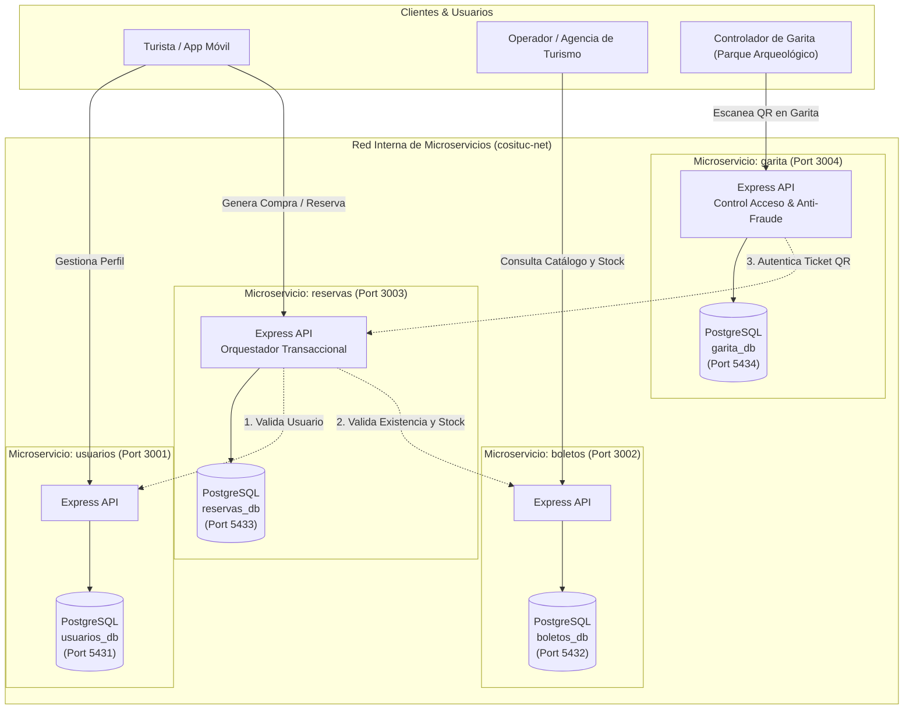

# Universidad Continental
## Facultad de Ingeniería — Carrera de Ingeniería de Sistemas e Informática
### Asignatura: Cloud Computing (Consolidado 2 — Unidad 3)
# Producto Académico N.º 3: Informe de Arquitectura de Microservicios en la Nube
---
# QosqoPass & Tours
### Sistema Distribuido en la Nube para la Emisión, Validación y Control de Aforo del Boleto Turístico del Cusco (COSITUC)
---
## Integrantes
* Alejandro Zavala, Rodrigo Josue
* Cortez Herrera, Sebastian Rodrigo
* Cisneros Nieto, Sabrina Andrea
* Cordova Alvarez, Gonzalo Sebastian
* Ccoyo Huaman, Jhojan Edwin
---

## Integrantes y Distribución del Trabajo

| Integrante | Rol en el Proyecto | Componentes y Entregables Desarrollados | Pull Request |
| :--- | :--- | :--- | :---: |
| **Alejandro Zavala, Rodrigo Josué** *(Líder)* | Líder del Repositorio & DevOps / Dev Garita | Gobernanza del repo central, reglas de protección de rama `main`, pipeline CI en GitHub Actions, microservicio `garita` (validación de QR, control anti-fraude y aforo en vivo) y consolidación final. | [PR #7](https://github.com/AlejandroContinental/cosituc-cloud-microservicios/pull/7) |
| **Cordova Alvarez, Gonzalo Sebastian** | Dev Microservicio Usuarios | Microservicio `usuarios` (API Express, conexión PostgreSQL `usuarios_db`, roles Turista/Agencia/Admin, `init.sql`, Dockerfile y pruebas unitarias con Jest). | [PR #3](https://github.com/AlejandroContinental/cosituc-cloud-microservicios/pull/3) |
| **Cisneros Nieto, Sabrina Andrea** | Dev Microservicio Boletos | Microservicio `boletos` (API Express, catálogo de circuitos BTC Integral y Parciales, aforo, PostgreSQL `boletos_db`, Dockerfile, tipado y pruebas Jest). | [PR #4](https://github.com/AlejandroContinental/cosituc-cloud-microservicios/pull/4), [PR #8](https://github.com/AlejandroContinental/cosituc-cloud-microservicios/pull/8) |
| **Cortez Herrera, Sebastian Rodrigo** | Dev Microservicio Reservas | Microservicio `reservas` (API Express, lógica transaccional, generación de QR con UUID, validación inter-servicio a usuarios/boletos, endpoint `/qr/:codigo_qr`, PostgreSQL `reservas_db`, Dockerfile y pruebas Jest). | [PR #5](https://github.com/AlejandroContinental/cosituc-cloud-microservicios/pull/5), [PR #9](https://github.com/AlejandroContinental/cosituc-cloud-microservicios/pull/9) |
| **Ccoyo Huaman, Jhojan Edwin** | Dev Infraestructura & Contingencia | Orquestación central multicontenedor con `docker-compose.yml`, bases de datos desacopladas, volúmenes de inicialización `init.sql`, puertos únicos y script de prueba de contingencia (`test_contingencia.sh`). | [PR #6](https://github.com/AlejandroContinental/cosituc-cloud-microservicios/pull/6), [PR #10](https://github.com/AlejandroContinental/cosituc-cloud-microservicios/pull/10), [PR #11](https://github.com/AlejandroContinental/cosituc-cloud-microservicios/pull/11) |

---

## PARTE 1. CONCEPCIÓN DEL PROYECTO Y PROBLEMÁTICA REAL

### 1.1 Contexto Geográfico, Social y Problemática Local
La región de Cusco es el epicentro del turismo en el Perú y en Sudamérica, recibiendo más de 3 millones de visitantes anuales que acceden a los atractivos del Valle Sagrado, la ciudad y parques arqueológicos (Sacsayhuamán, Ollantaytambo, Pisac, Chinchero, Moray, etc.). La administración y recaudación del Boleto Turístico del Cusco (BTC) está a cargo de **COSITUC** (Comité de Servicios Integrados Turístico Culturales del Cusco).

Actualmente, el sistema de comercialización y control de accesos presenta deficiencias estructurales graves:
1. **Cuello de botella y congestión masiva:** La venta física en taquillas y galerías de la Av. Sol genera largas colas que perjudican la experiencia del visitante.
2. **Plataformas monolíticas propensas a colapsar:** En horas pico de alta temporada (junio a agosto), los sistemas centralizados tradicionales colapsan ante picos de demanda simultánea.
3. **Imprecisión en el control de aforos en tiempo real:** No existe un registro instantáneo centralizado de cuántos turistas están dentro de Sacsayhuamán u Ollantaytambo en un momento dado, arriesgando la conservación patrimonial y sobrepasando la capacidad de carga fijada por el Ministerio de Cultura.
4. **Falta de desacoplamiento entre venta e ingreso en campo:** Si la plataforma web de pagos o reservas sufre una caída, las garitas de acceso en las puertas de los sitios arqueológicos quedan bloqueadas, impidiendo el ingreso físico de turistas que ya contaban con su boleto.

### 1.2 Análisis de Usuarios Objetivo y Condiciones del Entorno
La solución fue diseñada considerando las limitaciones reales de conectividad, dispositivos y hábitos de los usuarios en la región:

* **Turistas Nacionales y Extranjeros:** Acceden principalmente desde teléfonos inteligentes con planes de datos móviles variables (buena cobertura 4G/5G en la ciudad de Cusco, pero conectividad 3G o nula en trayectos rurales). Necesitan confirmación inmediata, emisión ágil y tickets digitales livianos con código QR (`BTC-XXXXXXXX`).
* **Operadores Turísticos y Guías Independientes:** Requieren consultar disponibilidad de cupos, stock de circuitos turísticos y emitir boletos para grupos de visitantes de forma rápida y programada sin colas presenciales.
* **Personal Controlador de Garita (Guardaparques / COSITUC):** Ubicados físicamente en los portones de acceso a los parques arqueológicos. Trabajan en condiciones de intemperie y redes inalámbricas inestables. Su microservicio debe ser ultra liviano, responder en milisegundos, almacenar los ingresos en su propia base de datos local y evitar que una saturación en la tienda web impida el acceso físico.

### 1.3 Propuesta de Solución: Arquitectura de Microservicios
Se desarrolló **QosqoPass & Tours**, una arquitectura distribuida nativa de la nube basada en 4 microservicios independientes, desacoplados y contenerizados bajo el patrón *Database per Service*:



### 1.4 Catálogo de Microservicios y Dominios

| Microservicio | Puerto Host | Base de Datos | Puerto BD | Responsabilidad de Dominio |
| :--- | :---: | :---: | :---: | :--- |
| **`usuarios`** | `3001` | `usuarios_db` | `5431` | Administración de identidades, perfiles y roles de acceso (`Turista`, `Agencia`, `Admin`). |
| **`boletos`** | `3002` | `boletos_db` | `5432` | Gestión del catálogo oficial de Boletos Turísticos (BTC Integral, Circuito 1 Sacsayhuamán, Circuito 2 Valle Sur), tarifas y control de aforo máximo. |
| **`reservas`** | `3003` | `reservas_db` | `5433` | Orquestación transaccional de compra, control de concurrencia y generación del ticket con identificador UUID y código QR (`BTC-XXXXXXXX`). |
| **`garita`** | `3004` | `garita_db` | `5434` | Control de acceso en sitio arqueológico, prevención de doble ingreso no autorizado (anti-fraude) y cálculo de visitantes en tiempo real por monumento. |

---

## PARTE 2. GOBERNANZA DEL REPOSITORIO Y TRABAJO COLABORATIVO

### 2.1 Configuración del Repositorio y Políticas de Rama
1. **Repositorio Central:** Creado bajo la cuenta del Líder del Proyecto: `AlejandroContinental/cosituc-cloud-microservicios`.
2. **Protección de la rama `main`:** Se implementó una regla de protección de rama (*Branch Protection Rule*) que bloquea los pushes directos y exige que todas las incorporaciones de código provengan de un Pull Request con al menos una (1) aprobación obligatoria y validación exitosa de la suite de pruebas automatizadas.
3. **Flujo de Trabajo Forking & Feature Branch:** Cada integrante clonó el repositorio, creó ramas temáticas con prefijos estandarizados (`feature/`, `feat/`, `fix/`, `test/`) y emitió Pull Requests hacia la rama principal.

### 2.2 Registro de Pull Requests Aprobados y Fusionados

| N.º PR | Rama Origen | Autor | Descripción del Cambio | Estado | Aprobado por |
| :---: | :--- | :--- | :--- | :---: | :--- |
| **#3** | `feature/microservicio-usuarios` | `GONZAcord` | Creación de API REST Express, PostgreSQL `usuarios_db`, `init.sql`, Dockerfile y tests Jest. | `Merged` | Alejandro Zavala |
| **#4** | `feature/microservicio-boletos` | `Sabri-1-1` | Creación de API REST Express, catálogo de circuitos BTC, `boletos_db`, Dockerfile y tests Jest. | `Merged` | Alejandro Zavala |
| **#5** | `feature/microservicio-reservas` | `SebasCortez` | Lógica de checkout transaccional con llamadas fetch inter-servicio a usuarios/boletos y tests Jest. | `Merged` | Alejandro Zavala |
| **#6** | `feature/infra-docs` | `JhojanEd` | Creación de la estructura base multicontenedor con `docker-compose.yml`. | `Merged` | Alejandro Zavala |
| **#7** | `feature/microservicio-garita` | `AlejandroContinental` | Creación del microservicio `garita`, base de datos `garita_db`, tests Jest e integración en pipeline CI. | `Merged` | Gonzalo Córdova |
| **#8** | `feature/microservicio-boletos` | `Sabri-1-1` | Fix de compatibilidad de Jest (`--forceExit`), validación de tipos numéricos y puerto 5432. | `Merged` | Alejandro Zavala |
| **#9** | `fix/reservas-env-qr-tests` | `SebasCortez` | Unificación de variables inter-servicio, endpoint `/qr/:codigo_qr`, uso de `crypto` y tests robustos. | `Merged` | Alejandro Zavala |
| **#10** | `fix/docker-compose-db-env` | `JhojanEd` | Configuración de 4 bases de datos PostgreSQL con puertos independientes y montaje de scripts `init.sql`. | `Merged` | Alejandro Zavala |
| **#11** | `feat/script-contingencia` | `JhojanEd` | Creación del script `test_contingencia.sh` para pruebas de caída de nodos y resiliencia. | `Merged` | Alejandro Zavala |

---

### Evidencia 1: Historial de Pull Requests Aprobados en GitHub


---

## PARTE 3. ARQUITECTURA TÉCNICA Y COMUNICACIÓN INTER-SERVICIO

### 3.1 Comunicación Sincrónica HTTP/REST entre Microservicios

#### A. Validación de referencias en `reservas` (Checkout Seguro):
Antes de registrar una compra, el microservicio de `reservas` realiza dos peticiones HTTP concurrentes hacia `usuarios` y `boletos` para verificar la existencia del cliente y la disponibilidad de cupos:

```javascript
// reservas/src/app.js - Validación Inter-Servicio
// 1. Verificar existencia del usuario
const userRes = await fetch(`${USUARIOS_URL}/usuarios/${usuario_id}`);
if (!userRes.ok) {
    return res.status(404).json({ error: 'El usuario especificado no existe' });
}

// 2. Verificar catálogo y disponibilidad de aforo/stock
const boletoRes = await fetch(`${BOLETOS_URL}/boletos/${boleto_id}`);
if (!boletoRes.ok) {
    return res.status(404).json({ error: 'El boleto especificado no existe' });
}
const boletoData = await boletoRes.json();
if (boletoData.stock < cantidad) {
    return res.status(409).json({ error: 'Aforo o stock insuficiente para la cantidad solicitada' });
}
```

#### B. Validación y Control Anti-Fraude en `garita` (Control de Puerta):
Cuando un turista presenta su entrada en la garita de Sacsayhuamán, el controlador escanea el código QR. El servicio `garita` consulta a `reservas` y verifica que el boleto no haya sido reingresado fraudulentamente en el mismo parque:

```javascript
// garita/src/app.js - Validación Anti-Fraude
// 1. Consulta inter-servicio hacia reservas por código QR
const reservaRes = await fetch(`${RESERVAS_URL}/reservas/qr/${encodeURIComponent(codigo_qr)}`);
if (reservaRes.status === 404) {
    return res.status(404).json({ error: 'Boleto o código QR no encontrado en el sistema central' });
}

// 2. Control anti-fraude: Validar que no haya sido usado previamente en este monumento
const duplicateCheck = await pool.query(
    `SELECT * FROM accesos_garita 
     WHERE UPPER(codigo_qr) = UPPER($1) AND LOWER(sitio_arqueologico) = LOWER($2) AND estado_acceso = 'PERMITIDO'`,
    [codigo_qr, sitio_arqueologico]
);

if (duplicateCheck.rowCount > 0) {
    return res.status(409).json({ error: `Acceso denegado: Este boleto ya fue utilizado en ${sitio_arqueologico}` });
}
```

### 3.2 Resiliencia y Prueba de Caída de Nodos (`test_contingencia.sh`)
Para validar el desacoplamiento de la arquitectura y la capacidad de recuperación ante fallos de infraestructura, se implementó el script automatizado `test_contingencia.sh`. El script simula la caída forzosa de un nodo crítico (`docker compose stop usuarios`), verifica que el resto de microservicios continúe operando y restaura el servicio sin pérdida de estado:

---

### Evidencia 2: Prueba de Caída y Recuperación de Contenedores


---

## PARTE 4. MATRIZ DETALLADA DE PRUEBAS AUTOMATIZADAS

Se diseñó e implementó un conjunto de **13 pruebas unitarias e inter-servicio** desarrolladas con **Jest** y **Supertest**, cubriendo respuestas exitosas, códigos de error de negocio y validación de tipos:

| N.º | Microservicio | Archivo de Prueba | Funcionalidad / Endpoint Evaluado | Comportamiento Esperado | Código HTTP | Resultado |
| :---: | :--- | :--- | :--- | :--- | :---: | :---: |
| **1** | `usuarios` | `tests/app.test.js` | `GET /health` | Retorna estado de salud del servicio de usuarios. | `200 OK` | ✅ PASS |
| **2** | `usuarios` | `tests/app.test.js` | `GET /usuarios` | Consulta el listado de usuarios registrados en la base de datos. | `200 / 500` | ✅ PASS |
| **3** | `boletos` | `tests/app.test.js` | `GET /health` | Retorna estado de salud del servicio de catálogo de boletos. | `200 OK` | ✅ PASS |
| **4** | `boletos` | `tests/app.test.js` | `GET /boletos` | Retorna catálogo de circuitos turísticos (BTC Integral y Parciales). | `200 / 500` | ✅ PASS |
| **5** | `reservas` | `tests/app.test.js` | `GET /health` | Retorna estado de salud del servicio de reservas y emisión. | `200 OK` | ✅ PASS |
| **6** | `reservas` | `tests/app.test.js` | `GET /reservas` | Lista todas las reservas emitidas con orden cronológico. | `200 / 500` | ✅ PASS |
| **7** | `reservas` | `tests/app.test.js` | `POST /reservas` | Valida que los campos obligatorios existan; responde 400 ante datos incompletos. | `400 Bad Request` | ✅ PASS |
| **8** | `reservas` | `tests/app.test.js` | `GET /reservas/qr/:qr` | Búsqueda indexada por código QR generado (`BTC-XXXXXXXX`). | `200 / 404` | ✅ PASS |
| **9** | `garita` | `tests/app.test.js` | `GET /health` | Retorna estado de salud del servicio de validación de garita. | `200 OK` | ✅ PASS |
| **10** | `garita` | `tests/app.test.js` | `GET /garita/accesos` | Retorna el historial de validaciones e ingresos registrados. | `200 / 500` | ✅ PASS |
| **11** | `garita` | `tests/app.test.js` | `POST /garita/validar` | Valida presencia de `codigo_qr`; rechaza petición sin código. | `400 Bad Request` | ✅ PASS |
| **12** | `garita` | `tests/app.test.js` | `POST /garita/validar` | Valida presencia de `sitio_arqueologico`; rechaza petición sin sitio. | `400 Bad Request` | ✅ PASS |
| **13** | `garita` | `tests/app.test.js` | `GET /garita/aforo/:sitio` | Calcula y retorna la cantidad de personas ingresadas hoy al atractivo. | `200 / 500` | ✅ PASS |

---

## PARTE 5. CONTENERIZACIÓN CON DOCKER Y ORQUESTACIÓN

### 5.1 Dockerfiles por Microservicio
Cada microservicio cuenta con su respectivo `Dockerfile` estandarizado bajo Node.js 18, aislando el contexto de dependencias y optimizando la construcción mediante `.dockerignore`:

```dockerfile
FROM node:18
WORKDIR /app
COPY package*.json ./
RUN npm install
COPY . .
EXPOSE 3004
CMD ["npm", "start"]
```

### 5.2 Orquestación Multicontenedor con Docker Compose
El archivo `microservicios/docker-compose.yml` orquesta los 8 contenedores (4 microservicios de aplicación + 4 bases de datos relacionales PostgreSQL 15) conectados en la red virtual tipo puente `cosituc-net`. Cada base de datos monta automáticamente su script `init.sql` mediante la ruta del entrypoint oficial `/docker-entrypoint-initdb.d/init.sql`:

---

### Evidencia 3: Contenedores Activos con Docker Compose


---

## PARTE 6. INTEGRACIÓN CONTINUA (CI) CON GITHUB ACTIONS

### 6.1 Diseño de la Pipeline de Integración Continua
En la ruta `.github/workflows/ci.yml` se configuró el flujo automatizado de CI que garantiza la calidad del código y la integridad del despliegue:

* **Disparadores (Triggers):** Se activa ante cualquier evento `push` a la rama `main` o ante la creación de un `pull_request` hacia `main`.
* **Etapa 1 (`test`):** Utiliza una estrategia matricial (`matrix: service: [usuarios, boletos, reservas, garita]`) para ejecutar en paralelo las suites de pruebas unitarias sobre runners limpios de Ubuntu (`ubuntu-latest`).
* **Etapa 2 (`docker-build`):** Condicionada a la aprobación de la etapa de tests (`needs: test`). Ejecuta `docker compose build` para verificar que todas las imágenes Docker compilen sin errores de sintaxis ni dependencias rotas.

```yaml
name: CI Pipeline - Microservicios COSITUC

on:
  push:
    branches: [ main ]
  pull_request:
    branches: [ main ]

jobs:
  test:
    name: Pruebas Unitarias - ${{ matrix.service }}
    runs-on: ubuntu-latest
    strategy:
      matrix:
        service: [usuarios, boletos, reservas, garita]
    steps:
      - name: Checkout del código
        uses: actions/checkout@v4
      - name: Configurar Node.js 18
        uses: actions/setup-node@v4
        with:
          node-version: 18
      - name: Instalar dependencias
        working-directory: microservicios/${{ matrix.service }}
        run: npm install
      - name: Ejecutar pruebas unitarias
        working-directory: microservicios/${{ matrix.service }}
        run: npm test

  docker-build:
    name: Verificación de Construcción Docker
    needs: test
    runs-on: ubuntu-latest
    steps:
      - name: Checkout del código
        uses: actions/checkout@v4
      - name: Construir imágenes con Docker Compose
        run: docker compose -f microservicios/docker-compose.yml build
```

---

### Evidencia 4: Pipeline de CI Ejecutada con Éxito (16 Corridas en Verde)


---

## PARTE 7. GUÍA DE INSTALACIÓN, DESPLIEGUE Y PRUEBAS

Para replicar y evaluar la solución en un entorno local (Linux / WSL 2 con Docker Desktop):

### 1. Clonar el repositorio
```bash
git clone https://github.com/AlejandroContinental/cosituc-cloud-microservicios.git
cd cosituc-cloud-microservicios/microservicios
```

### 2. Construir y levantar todos los microservicios con Docker Compose
```bash
docker compose up --build -d
```

### 3. Verificar el estado de los contenedores
```bash
docker compose ps
```

### 4. Probar endpoints de la solución

* **Healthchecks de los 4 servicios:**
  ```bash
  curl http://localhost:3001/health  # Usuarios
  curl http://localhost:3002/health  # Boletos
  curl http://localhost:3003/health  # Reservas
  curl http://localhost:3004/health  # Garita
  ```

* **Consultar catálogo de boletos turísticos (COSITUC):**
  ```bash
  curl http://localhost:3002/boletos
  ```

* **Simular emisión de reserva con validación inter-servicio:**
  ```bash
  curl -X POST http://localhost:3003/reservas \
    -H "Content-Type: application/json" \
    -d '{"usuario_id": 1, "boleto_id": 1, "fecha_visita": "2026-12-20", "cantidad": 2}'
  ```

* **Simular validación de ingreso en garita (Sacsayhuamán):**
  ```bash
  curl -X POST http://localhost:3004/garita/validar \
    -H "Content-Type: application/json" \
    -d '{"codigo_qr": "BTC-B19A2B84", "sitio_arqueologico": "Sacsayhuamán", "controlador_id": 101}'
  ```

* **Consultar aforo en tiempo real del parque arqueológico:**
  ```bash
  curl http://localhost:3004/garita/aforo/Sacsayhuamán
  ```

### 5. Ejecutar la prueba de contingencia
```bash
bash test_contingencia.sh
```

---

## Conclusiones

1. **Viabilidad e Impacto:** La separación del ciclo de vida de la venta web (`reservas`) respecto a la validación física en campo (`garita`) resuelve el cuello de botella histórico de COSITUC, permitiendo controlar aforos en tiempo real y garantizando que una saturación en la pasarela de pagos no paralice el ingreso de turistas a los parques arqueológicos.
2. **Patrón Database per Service:** Asignar bases de datos PostgreSQL independientes con puertos dedicados y esquemas propios evitó el acoplamiento a nivel de datos y permitió que cada microservicio escale de forma autónoma.
3. **Automatización y Calidad:** La integración continua con GitHub Actions validó cada Pull Request con 13 pruebas unitarias e inter-servicio, alcanzando 16 ejecuciones exitosas consecutivas y demostrando una metodología de desarrollo colaborativo rigurosa y verificable.

